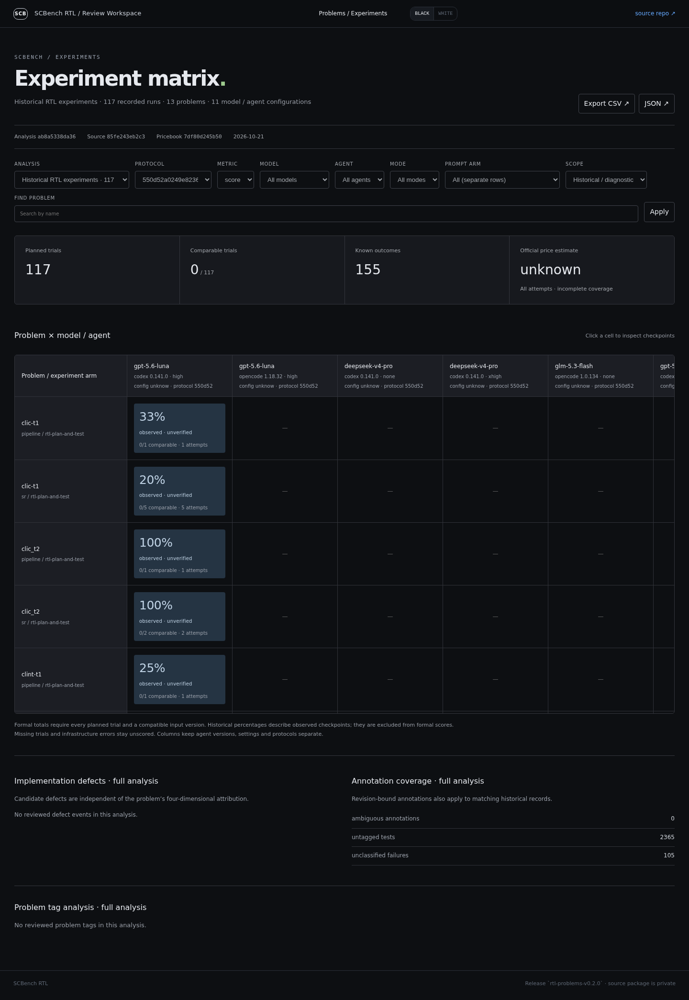
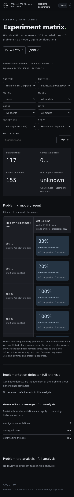

# Experiment matrix

Open `#experiments`. Filter by model, agent, protocol, mode, prompt arm, analysis
revision and formal/diagnostic scope. Agent versions, effective configurations and
thinking settings stay separate. Click a cell for checkpoint outcomes, exact test
nodes, implementation defect annotations, candidate archive links and usage.
Filters and detail selection are represented in the URL. CSV exports escape
spreadsheet formula prefixes. Per-problem test details load on demand.

Source: `scbench-rtl-problems/experiments/catalog.json`. `sync-experiments.mjs`
verifies every dependency hash before replacing the public manifest. The existing
sync pins the source commit for problem and experiment reads, and uses the existing
private-repository secret. No new secret is required for scheduled synchronization.
The optional source dispatch example now covers `experiments/**`.

The initial dataset contains 117 existing records for 13 problems. Percentages
marked **observed · unverified** describe recorded checkpoints and are excluded
from formal comparable scores. These imports lack a complete input identity and
independent-trial protocol. Missing costs and HTTP call counts remain unknown;
native steps are labelled separately from model requests. Candidate defects and
problem classification are independent of four-dimensional problem attribution.
Annotation/pricebook changes create a new immutable analysis release.

Formal aggregate scores require complete planned coverage and compatible input
generations. Missing trials and execution errors are not zero scores. A model
failure can be a completed trial. Overview defect/annotation statistics explicitly
apply to the whole selected analysis; the matrix follows the active filters.

Validation: `node --test tests/*.test.mjs`. Browser checks cover desktop, 390px
mobile, scrolling, detail loading, search, CSV download and the existing problems
route. Browser checks make no model API calls. A separate bounded integration canary remains diagnostic; it found invalid credentials and missing native usage in the configured channels.

